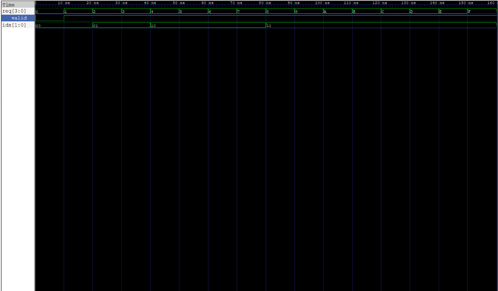

# 4-Bit Priority Encoder

A synthesizable Verilog-2001 priority encoder with a valid flag, verified with an exhaustive self-checking testbench.

## Skills Demonstrated

- Synthesizable RTL design in Verilog-2001
- Combinational logic design from a truth table with don't-care compression
- Latch-free coding (default assignments in `always @(*)`)
- Exhaustive self-checking testbench with an independent reference model
- Waveform debugging with GTKWave
- Synthesis checking with Yosys (cell count, latch detection)
- Documented design decisions and scripted builds (Makefile)

## Overview

A priority encoder takes several request lines and reports the index of the
highest-priority active request. This design uses 4 inputs, with `req[3]` as
the highest priority. It is the same idea an interrupt controller uses to
decide which pending interrupt to service first.

## Interface

| Port | Direction | Width | Description |
|---|---|---|---|
| `req` | input | 4 | Request lines, `req[3]` has highest priority |
| `idx` | output | 2 | Index of the winning request |
| `valid` | output | 1 | High when at least one request is active |

## Block Diagram

```
             +--------------------+
 req[3:0] -->|                    |--> idx[1:0]
   (4 bits)  |  priority_encoder  |     (2 bits)
             |                    |--> valid
             +--------------------+     (1 bit)
```

## Design Decisions

- **MSB wins:** the most significant bit is the highest priority, matching
  how binary numbers are read and how many interrupt controllers are organized.
- **`valid` output:** `idx = 00` alone is ambiguous (request 0 won, or no
  request). `valid` removes the ambiguity.
- **No-request behavior:** `idx = 00` and `valid = 0`, so outputs are always
  defined values and never `x`.
- **Latch avoidance:** both outputs get default values at the top of the
  `always @(*)` block, so every path assigns every output.

Full truth table, compressed truth table, and Boolean equations are in
[docs/truth_table.md](docs/truth_table.md).

## Verification

The testbench applies all 16 input combinations (exhaustive) and compares
`idx` and `valid` against an independent reference model that scans the
request bits from 0 up to 3. It uses `!==` so unknown values (`x`, `z`) are
flagged as failures.

Result:

```
PASS: req=0000 idx=00 valid=0
...
PASS: req=1111 idx=11 valid=1
ALL 16 TESTS PASSED
```

Waveform:



## Synthesis Results (Yosys, generic gates)

```
5 cells
  1  $_ANDNOT_
  4  $_OR_
```

- No latches and no flip-flops (purely combinational)
- Logic depth of 2 gates
- Yosys shared `req[3] | req[2]` between `idx[1]` and `valid`
- On a 7-series FPGA, each output fits in one LUT (3 LUTs total)

## How to Run

Requires Icarus Verilog, GTKWave, and Yosys.

```
make sim     # compile and run the testbench
make wave    # open the waveform in GTKWave
make clean   # remove generated files
```

Synthesis check:

```
yosys -p "read_verilog rtl/priority_encoder.v; synth -top priority_encoder; stat"
```

## Project Structure

```
01_priority_encoder/
  rtl/priority_encoder.v
  tb/tb_priority_encoder.v
  docs/truth_table.md
  docs/waveform.png
  Makefile
  README.md
```

## Lessons Learned

- A passing simulation does not prove clean hardware. Synthesis is what
  reveals inferred latches.
- Writing the truth table first made the RTL a direct translation of the
  compressed table.
- Add your latch experiment result here after you run it.